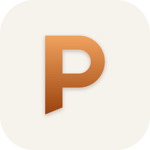
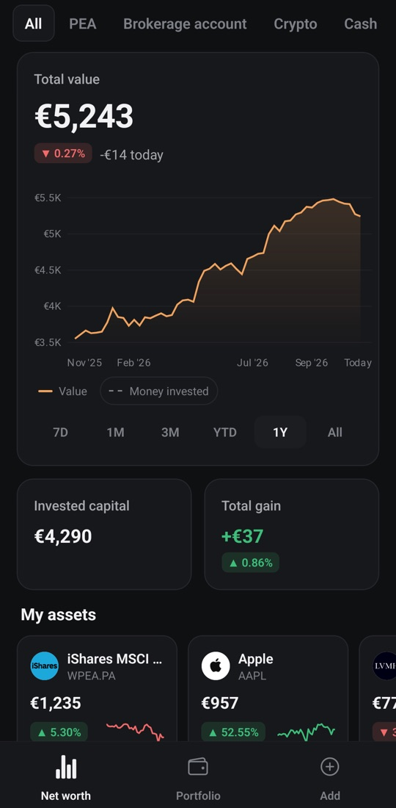
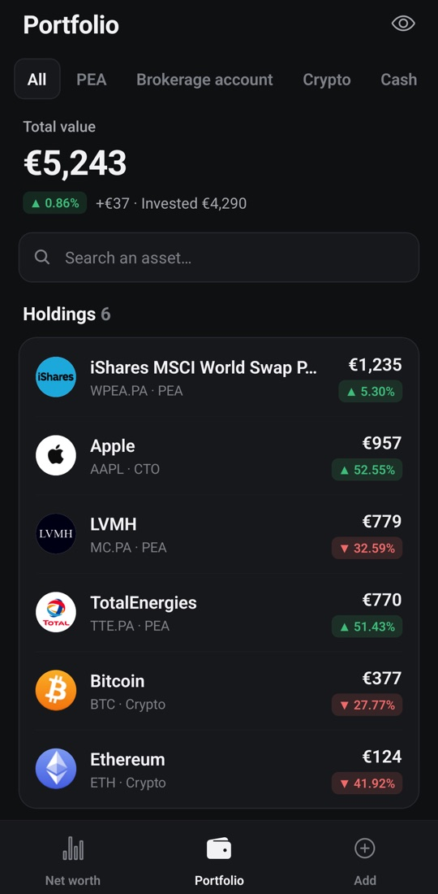
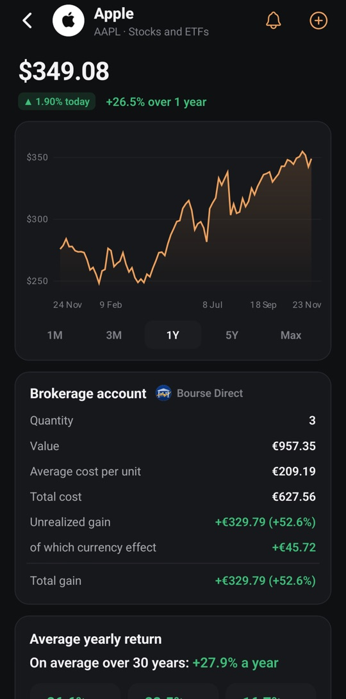
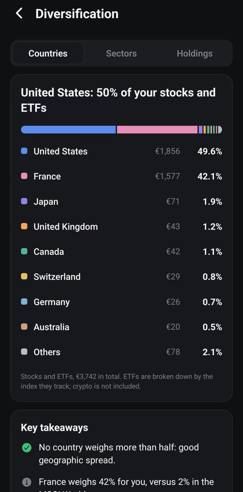
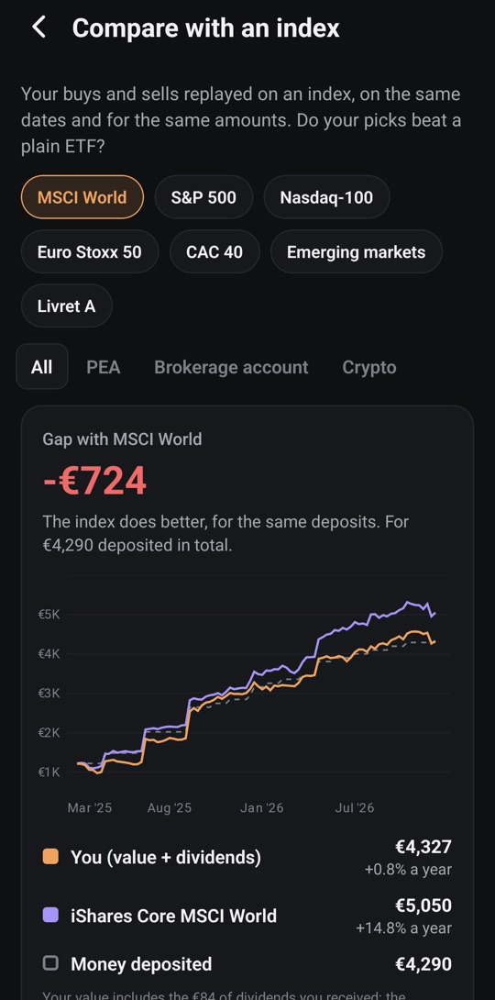
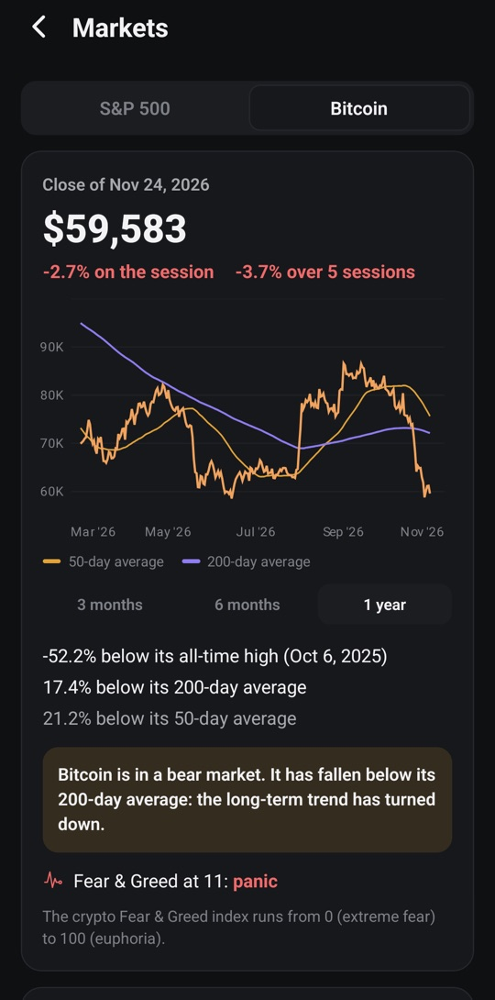

<div align="center">
  
  <h1>Patrimo</h1>
  <p>Your whole net worth in one place, made for investors in France. No account, no cloud: everything stays on your phone.</p>

  
  
  
  

  <p><a href="README.fr.md">Lire en français</a></p>
</div>

## Made for France

Patrimo is built around investing in France: the PEA and its cap, the Livret A and other regulated savings accounts, French brokers' fees, French inflation, and the capital gains tax forms. Stocks, ETFs and crypto work from anywhere and the app speaks 6 languages, but the savings, fees and tax pages only make sense if you invest in France.

## Features

- [x] Stocks, ETFs, crypto, savings accounts, life insurance, employee savings, loans and real estate, all in one net worth
- [x] PEA and its €150,000 cap, Livret A, LDDS, LEP and other regulated savings accounts, with their official rates
- [x] Tax help for the French capital gains forms (2074 for stocks, 2086 for crypto)
- [x] Real performance: price moves, currency effect, realized gains and dividends, annualized return (IRR) before and after inflation
- [x] Compare your deposits with an index (MSCI World, S&P 500, Nasdaq-100, CAC 40) or a Livret A, at the same dates
- [x] Dividends: calendar, yield on cost, 12-month projection, and reminders for the ones you haven't logged yet
- [x] Diversification by country and sector, with ETFs broken down by the index they track
- [x] Budget as a Sankey diagram, savings rate, goals, emergency fund and financial independence
- [x] Loans, real estate and a purchase simulator (notary fees, monthly payment, 35% debt ratio)
- [x] Optional bank sync through GoCardless, with your own free keys
- [x] Price alerts, home screen widget, PIN and biometric lock, privacy mode that hides every amount
- [x] Backup to a file, and a demo mode (made-up portfolio, budget and profile) to try or show the app without revealing anything of yours
- [x] 6 languages: English, French, Spanish, Portuguese, German, Italian
- [x] Free, no ads, no account, no tracking, entirely open source

## Download

[](https://apps.obtainium.imranr.dev/redirect?r=obtainium://add/https://github.com/matteogalfre/Patrimo)
[](https://github.com/matteogalfre/Patrimo/releases/latest)

Obtainium keeps the app up to date straight from this repository's releases.

## Screenshots

<div align="center">
  
  
  
  
  
  
</div>

Sample data from the app's demo mode.

## Bank sync (optional)

Patrimo can refresh the balance of your current and savings accounts on its own, through [GoCardless Bank Account Data](https://gocardless.com/bank-account-data/) (PSD2, read-only: account names and balances, never your transactions or credentials).

1. Create a free account on the GoCardless Bank Account Data portal, then Developers › User secrets › Create new.
2. In Patrimo, open Settings › Linked banks and paste the Secret ID and Secret Key.
3. Pick your bank and give your consent on your bank's own site. Patrimo never sees your login.

Your keys stay in the phone's secure storage and never go into backups. Patrimo talks to GoCardless directly, there is no Patrimo server in between. Consent lasts 90 to 180 days depending on the bank, then renews in two taps. Brokers are not covered.

## Where the numbers come from

- Stocks, ETFs and funds: Yahoo Finance
- Crypto: Binance public API
- Exchange rates: European Central Bank reference rates via [Frankfurter](https://frankfurter.dev)
- Inflation: Eurostat's harmonised consumer price index for France
- ISIN search: [OpenFIGI](https://www.openfigi.com)
- Fear & Greed index: alternative.me
- Logos: CoinCap for crypto, Financial Modeling Prep for stocks, and Google's public favicon service for banks and brokers

None of them needs an account or a key, and they only see which symbols are asked for, never your amounts. How each figure is calculated (cost basis, currency effect, IRR, inflation) is explained in the [French README](README.fr.md#comment-les-chiffres-sont-calculés).

## Run it locally

```bash
npm install
npx expo start      # then press "a" for Android
npm run verify      # lint, tests and import checks
```

## Feedback and contributions

***All contributions are very welcome!***

- Bug reports and feature requests go [here](https://github.com/matteogalfre/Patrimo/issues). The forms tell you what to include.
- A broker's fees, a savings rate or an ETF's breakdown is out of date? These live in [`src/constants/`](src/constants/): open an issue or a pull request with the source.
- Developers: fork the project and open a pull request.

## Translation

Patrimo speaks English, French, Spanish, Portuguese, German and Italian. Found a clumsy sentence, or want your language? Each language is one file in [`src/i18n/translations/`](src/i18n/translations/): copy `en.js`, translate it and open a pull request.

## Privacy

Patrimo has no server and no account. Your data lives on your phone, and only leaves it when you export a backup yourself. The app only fetches public market data and logos, plus your balances from GoCardless if you turn bank sync on.

## License

Patrimo is licensed under the [GNU General Public License v3](LICENSE): you can use, study, change and share it, as long as your version stays open too.

Patrimo is a tracking tool, not financial or tax advice.
